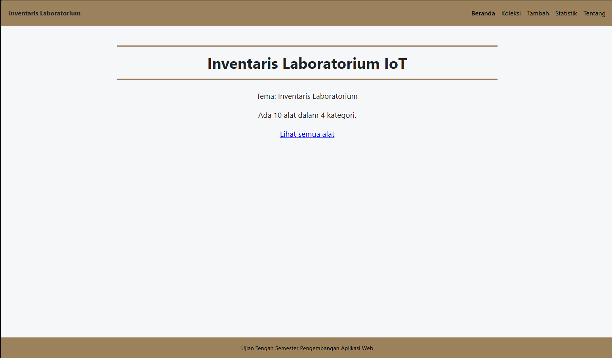
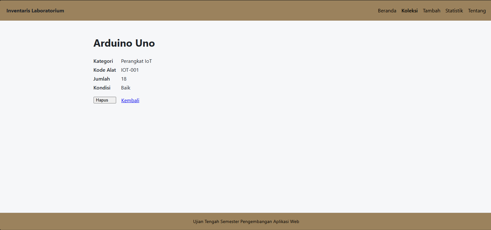
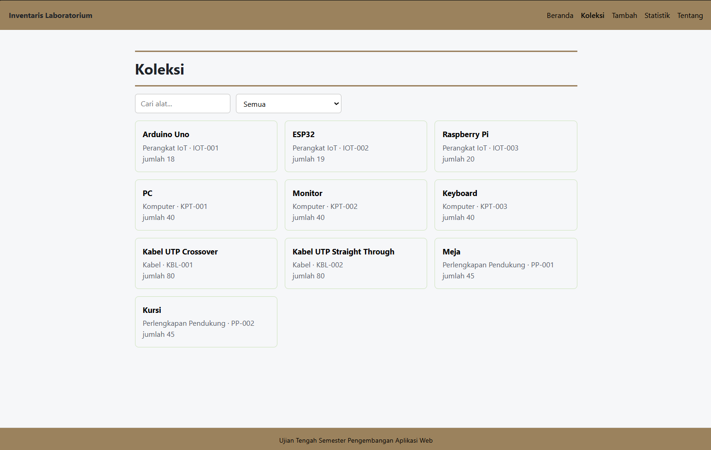
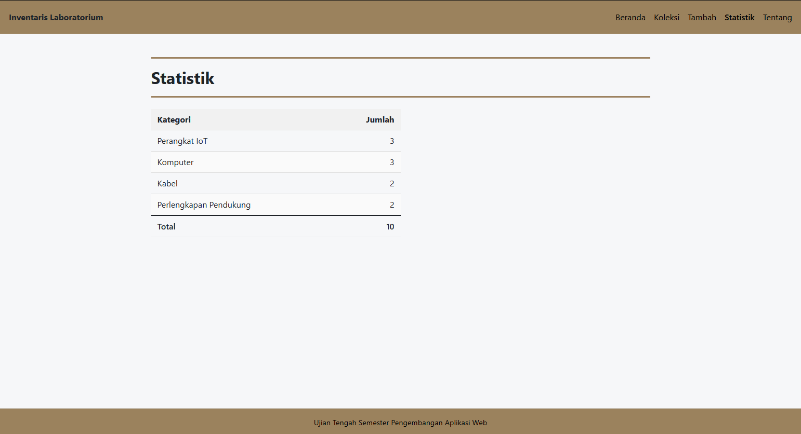
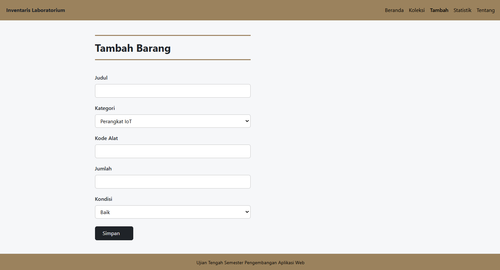
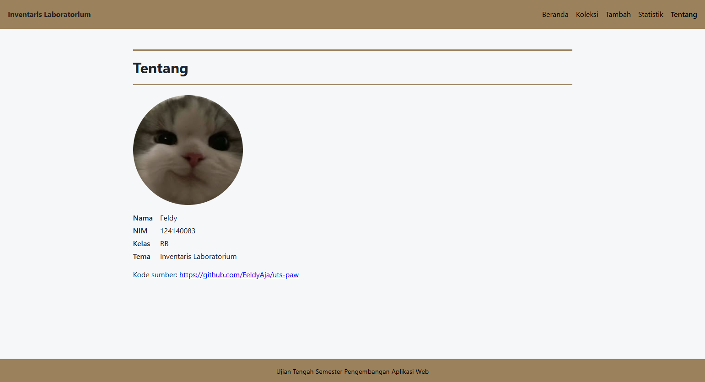
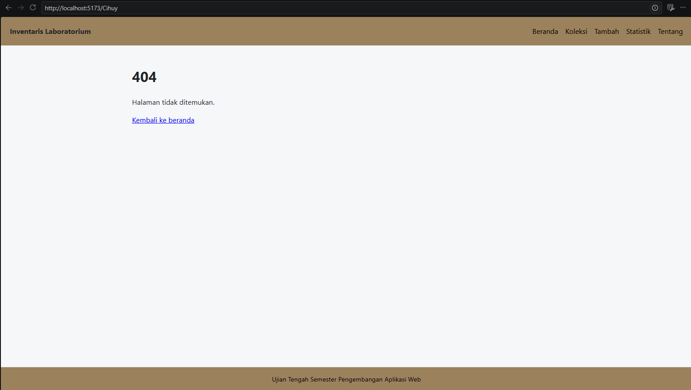

# Ujian Tengah Semester IF25-22014 Pengembangan Aplikasi Web

Repo induk Ujian Tengah Semester Pengembangan Aplikasi Web, Informatika ITERA, semester ganjil 2026/2027.

# Nama Aplikasi

Nama: Feldy
NIM: 124140083
Kelas: RB
Tema: Inventaris Laboratorium
Deployment: https://FeldyAja.github.io/uts-paw/

## Fitur

- Menampilkan daftar alat yang ada di data lab dalam bentuk kartu
- Setiap kartu memiliki detail awal, yaitu menampilkan kategori, kode alat, dan jumlah
- Memiliki kolom pencarian berdasarkan nama alat
- Memiiki pencarian alat berdasarkan filter kategori
- Dapat menambahkan barang/alat dengan mengisi nama alat (judul), kategori, kode alat, jumlah, dan kondisinya
- Memunculkan peringatan/pemberitahuan bila mengisi nama alat (judul) kurang dari 3 karakter
- Menampilkan tabel statistik, berisi jumlah nama alat dalam kategori (bukan jumlah alat satuan) dari setiap kategori & jumlah totalnya
- Menampilkan halaman tentang yang berisi foto profil github, nama, nim, dan kelas pembuat.
- Menampilkan Halaman 404 bila masuk ke alamat yang tidak dikenal

## Menjalankan secara lokal

cd app
npm install
npm run dev

## Konsep React yang dipakai

- Component : untuk membagi tampilan menjadi beberapa bagian yang dapat digunakan kembali.
- Props : untuk mengirim data antar component.
- useState : untuk menyimpan dan mengubah data pada halaman.
- useEffect : untuk menjalankan proses saat component ditampilkan, seperti mengambil data.
- Context : untuk membagikan data koleksi antar halaman.
- React Router : untuk mengatur perpindahan antar halaman.
- Testing dengan Vitest (npm test)
